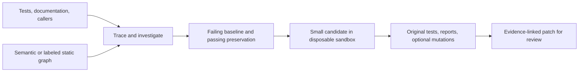

# Octane for OpenClaw

Octane helps an OpenClaw agent understand a project, trace behavior through functions and imports, and make small bug fixes supported by tests. It combines source analysis, runtime traces, persistent investigation records, and a local evidence CLI in one plugin and one `octane` skill.

Ask **“Fix a bug.”** The workflow finds a baseline check, looks for evidence of intended behavior, reproduces the defect, and follows the affected path before editing. It then reruns the reproduction and checks that neighboring behavior still works. The OpenClaw agent supplies reasoning through its configured model provider.

## Install

Use OpenClaw 2026.5.17+, Node.js `^24.22.1` or `>=26.12.1`, and Python 3.11+ on the Gateway host. Docker is used for isolated execution; rootless Podman and configured gVisor adapters are also available.


| Component | Compatibility |
| --- | --- |
| OpenClaw | Declared minimum 2026.5.17; runtime checked on 2026.11.3 |
| Node.js | `^24.22.1` or `>=26.12.1`; checked on 26.13.0 |
| Python package, native tools, MCP bridge | 3.11+ |
| Checkout-only `scripts/octane.py` ledger/static CLI | 3.9+, standard library; Python 3.9 cannot pip-install this package |
| Execution | Local approved Docker images; rootless Podman/runsc adapters require deployment validation |
| Host platforms | Linux tested; POSIX state modes applied; Windows profile permissions and explicit container-user opt-in |

From this checkout:

```sh
npm ci --omit=peer
openclaw plugins install --link .
```

Configure `plugins.entries.octane.config.allowedProjectRoots` with the absolute directories Octane may inspect and authorize the relevant tools. For Docker experiments, allow `octane_workspace`, choose trusted images in `allowedDockerImages`, and pull those images locally. Follow the [plugin setup guide](openclaw/README.md) for a complete configuration.

Check registration and discovery:

```sh
openclaw plugins inspect octane --runtime --json
openclaw skills list
```

The manifest loads the repository's root [Octane skill](SKILL.md). The same skill can be installed directly when using its command-line tools:

```sh
openclaw skills install git:tempothrone-star/Octane
```

## Investigate and repair

Use `/skill octane Fix a bug.` to invoke the workflow explicitly. OpenClaw can also expose it as `/octane`. [OpenClaw skill commands](https://docs.openclaw.ai/tools/slash-commands#skill-commands)

1. **Establish a baseline.** `octane_context` with `triage` reads project metadata and suggests relevant checks. A request without symptoms starts from the declared test command and a boundary case grounded in existing tests or documentation.
2. **Follow the affected path.** `focus` accepts a path or function name and returns bounded static relationships, source locations, and a Mermaid plot. Register and scan the project for a broader persistent graph.
3. **Confirm intended behavior.** Use user requirements, existing tests, documentation, and callers to establish what the program should do. Trace a focused reproduction and record observations separately from hypotheses.
4. **Validate the smallest correction.** Pair a failing baseline with a passing candidate and separate preservation checks. Review the diff, paired outputs, and recorded intent before applying the patch.

Saved investigations carry evidence references, revision information, and exploration checkpoints across sessions. The [native workflow guide](docs/openclaw.md) shows the tool calls and the Docker repair demonstration.

## Function graphs and runtime traces

- Optional operator-configured Pyright and TypeScript language servers provide semantic call hierarchy with labeled static fallback. Python analysis also uses its built-in AST and lexical scopes. The optional Tree-sitter extra adds syntax-level call candidates across languages including C, C++, C#, Go, Java, JavaScript, PHP, Ruby, Rust, and TypeScript.
- Runtime probes support Python calls and exception locations, Node.js sampling, Ruby method calls, GDB traces for debug binaries, and compatible Speedscope profiles.
- File and import graphs cover additional language families. Configure custom suffixes and import forms with a data-only `.octane/languages.json`.

Install the parser extra from this checkout using the interpreter configured as `pythonExecutable`:

```sh
python3 -m pip install '.[ast]'
```

Coverage depends on grammar, scan budget, and the executed input. Use the reported gaps and source evidence when investigating dynamic dispatch or cross-language calls. See the [supported trace options](openclaw/README.md#multilingual-function-graphs-and-traces).

## Command-line tools

Use `python3 scripts/octane.py --help` from this checkout or `python3 -m octane --help`. Installing the Python package also provides the `octane` command. From a source checkout, `scripts/octane.py` ledger and static commands work with Python 3.9+ and the standard library. Installing with pip, native tools, and optional extras require Python 3.11+.

To analyze another checkout, set `OCTANE_CLI` to the absolute path of this repository's `scripts/octane.py` and run commands with the target checkout as the working directory.

```sh
python3 "$OCTANE_CLI" init
python3 "$OCTANE_CLI" status
python3 "$OCTANE_CLI" evidence add \
  --type source_observation \
  --description "The parser calls normalize_input before validation" \
  --file src/parser.py --symbol parse_input
python3 "$OCTANE_CLI" claim add \
  --kind hypothesis --text "Normalization may change the value before validation" \
  --evidence EV-0001
python3 "$OCTANE_CLI" brief --task "trace parser validation" --budget-tokens 1200
```

Replace `EV-0001` with the returned evidence ID. Use `languages` for source inventory, `graph` for file dependencies, and `locate --trace-file failure.log` to rank files from a saved failure trace. `--human` produces readable output. `--format compact` produces compact JSON. Use `--agent` or `OCTANE_AGENT` to select a registered local identity.

`octane native --help` exposes the existing Gateway database registration, scanning, and demonstration commands.

## Evidence and integrations

The same twelve tools are available through `octane-mcp` over stdio. Optional integrations add semantic Python/TypeScript edges, structured test and line-coverage reports, SARIF, mutation experiments, Hypothesis/fast-check probes, Git bisect, GitHub issue/CI evidence, Sentry/OTEL imports, offline signed in-toto provenance, and local SWE-bench-style replay. Setup, exact actions, dependencies, and verification limits are in the [integration guide](docs/integrations.md).

Candidate runs execute original baseline checks through read-only overlays. Proposals reject test edits unless an explicit flag and rationale are recorded. A matched reproduction, preservation checks, current intent evidence, image identity, and source hashes remain required. Mutation evidence can test whether selected source reversions recreate the failure.



For example, the numeric repair fixture preserves the missing-input sentinel while correcting zero:

```diff
 def normalize(value):
-    return value or None
+    return value
```

Before: `calculate(0)` returns `-1`. After: it returns `0`; `calculate(None)` still returns the documented `-1`. The container demonstration checks the focused failure and neighboring behavior. The public [Blinker replay](docs/evaluation.md) separately validates the harness against a historical maintainer fix.

A real `status --human` run after recording one source observation produced the following excerpt (identity/path/hash fields omitted):

```text
open_investigations: 0
stale_or_needs_review_claims: 0
asserted_claims: 0
unverified_evidence: 1
log_integrity:
valid: True
  events: 3
```

## Storage and upgrades

New project-local ledger records use `.octane/ledger.db` with `project.json` and `config.json`. Gateway investigations use `pil.sqlite3` and disposable workspaces under `$OPENCLAW_STATE_DIR/octane`, or `~/.openclaw/octane` when the variable is unset. Keep Gateway storage outside analyzed checkouts. POSIX state directories are private (0700) and database/metadata files use 0600; Windows relies on user-profile access controls.

Existing `.octance/octance.db` ledgers are opened in place with their records and event hashes preserved. The old `scripts/octance.py` entry point and `OCTANCE_AGENT` variable remain compatibility aliases. If a checkout contains both old and new ledger state, Octane reports a conflict so the active records can be selected explicitly. Upgrade the linked plugin and refresh the skill catalog to replace the former `octance` skill name.

Docker runs use disposable snapshots, disabled container networking, and resource limits. Keep credentials outside source trees and evidence payloads. OpenClaw tool policy governs project and execution access.

## Development

```sh
PYTHONDONTWRITEBYTECODE=1 python3 -m unittest discover -s tests -v
npm test
```

[CI](.github/workflows/tests.yml) exercises the local CLI on Python 3.9, the full suite on Python 3.11, 3.12, and 3.14, optional parsing, Node bridge and packaging, Docker repair/mutation/bisect/report/property checks, live language servers, offline signature tests, curated lint, and coverage gates. See the [architecture](docs/architecture.md), [workflow](docs/openclaw.md), and [implementation limits](docs/implementation-and-limitations.md).
