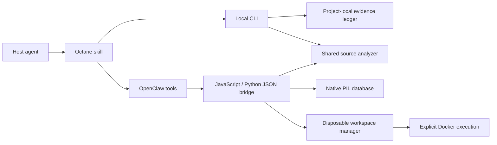

# Project review

This document records the PR #6 snapshot. For version 0.2.0 changes, updated coverage gates, and remaining integration limits, see the [follow-up review](follow-up-review.md).

Octane combines local evidence, source analysis, saved investigations, and Docker validation in one plugin. The root skill is the single workflow entry point. Source analysis is shared by the CLI and OpenClaw tools.

## November 20, 2026 upgrade

The full requested roadmap now shares the existing twelve tool names, one source analyzer, one skill, and the established execution boundary. It adds stdio MCP, operator-configured Python/TypeScript language servers, structured reports and line coverage, bounded mutation experiments, Hypothesis/fast-check probes, GitHub and SARIF evidence, container-backed bisect, Sentry/OTEL file imports, offline in-toto DSSE signatures, rootless Podman/runsc adapters, and a local historical evaluation harness. [Configuration and limits](integrations.md).

The proposal gate protects original tests through read-only overlays and requires an explicit flag plus rationale for test-like edits. Mutation scores attached to proposals are computed from underlying matched execution records. Secret snapshot filters, Windows UID/GID refusal, POSIX private storage modes, the MIT license, no-reply commit metadata, curated lint, coverage gates, pinned Actions, and Dependabot address the hardening review.

Live validation: 172 Python tests passed with two expected dependency-absence skips, including Docker, optional Tree-sitter, Pyright, TypeScript language server, Hypothesis, fast-check, and offline Ed25519 signatures. All 46 checkout CLI tests passed in Python 3.9. Five Node tests passed, including actual MCP SDK clients. OpenClaw 2026.11.3 loaded twelve tools and discovered one eligible Octane skill in an isolated configuration. A clean wheel installation initialized both stores and scanned a project. The [Blinker historical replay](evaluation.md) resolved one supplied maintainer patch with its affected file ranked first; this is not a general accuracy estimate.

Podman/runsc were not installed on this host; their policy and argument tests use controlled runners. GitHub write integration tests use canned transport responses. Current CI results must be checked on the new PR; the older CI results below describe prior releases.

### SQL and exception audit

The no-Docker coverage run passed 172 tests with ten integration/dependency skips, reaching 78% overall coverage and 100% for `experiments.py`. At that snapshot, CI enforced floors of 69% overall and 85% for the proposal gate.

Native SQL values use bound placeholders. The interpolated identifiers in `db_graph.py` come from fixed path/language fields, fixed source/target choices, or fixed predicates; search values remain bound. `db.py` invalidation statements use fixed identifiers and bound paths; transaction savepoints use generated UUID names. Portable ledger queries concatenate fixed predicates or generated placeholder counts with separately bound values. No reviewed statement inserts a caller-supplied SQL identifier.

Broad catches in native database transactions, workspace creation cleanup, and portable ledger writes roll back or remove partial state and immediately re-raise. The bridge's outer catch deliberately converts an error into its JSON protocol response. Optional parser catches were narrowed to known API/parse/ABI failure classes, with explicit static fallback coverage. No transaction error is converted into a passing run.

The scanner now separates snapshot reading and consistency verification; investigation validation and adjacency construction are extracted; execution option validation, engine selection, and container argument construction are separate. `db_schema.py`, `db_support.py`, and `db_graph.py` divide native persistence concerns; `bridge_support.py` and `bridge_workspace.py` divide tool handlers. These retain the existing transactions and public APIs.

The sections below retain the earlier defect history and release validation for comparison.

## Component map

| Component | Responsibilities | State and boundaries |
| --- | --- | --- |
| `SKILL.md` | Host-agent workflow and capability limits | One skill registered by the plugin manifest |
| `scripts/octane.py`, `octane/__main__.py` | Command dispatch | Local evidence commands and native database commands |
| `octane/ledger/cli.py` | Argument validation, identity/permission checks, JSON responses | Local commands support Python 3.9+ with the standard library |
| `octane/ledger/core.py` | Project identity, evidence, claims, search, event reducers, integrity, briefings | `.octane/ledger.db`, `project.json`, and `config.json` per project |
| `source.py`, `polygraph.py`, `ast_backend.py` | Extension inventory, trace ranking, dependency extraction, optional Tree-sitter parsing | Read-only heuristics; do not execute analyzed code or establish causation |
| `openclaw/index.js`, `openclaw/bridge.js` | Register 12 optional native tools and transport JSON to Python | Operator-configured project roots; subprocess size and timeout limits |
| `octane/openclaw_bridge.py`, `octane/db.py` | Native tool dispatch and Project Intelligence Layer | Gateway-side, operator-configured SQLite database |
| `octane/repair.py`, `octane/focus.py`, `octane/scanner.py` | Checkout triage, working-copy symbol lookup, and persisted multilingual indexing | Bounded static analysis with parser coverage |
| `octane/investigation.py`, `octane/workspace.py`, `octane/experiments.py` | Saved exploration, snapshot comparison, runtime traces, and patch proposals | Execution uses explicit commands and approved Docker images. Proposals store the diff with paired checks and intent evidence. |

Portable ledger writes validate the actor and references, redact recognized secret patterns, compute a source revision, and append an event and its materialized records in one SQLite transaction. The external JSON log anchor advances after the database commit. Reads reconstruct effective claim statuses from append-only transitions. Search prefers FTS5 and falls back to SQL candidate filtering plus whole-term matching.

## Fixes and regression coverage

The November 15, 2026 review reproduced each defect below with a failing regression test before its fix.

| Defect | Result after the change |
| --- | --- |
| Evidence search fallback inspected `payload_json` after row conversion had renamed it to `payload` | Terms found only in nested structured evidence are returned without FTS5 |
| An explicit idempotency key could return another agent's evidence record | Reusing a key with a different actor is rejected |
| Explicit status retries compared mutable predecessor state or bypassed conflict checking | A retry returns the original transition without reapplying it; incompatible reuse is rejected even when the requested status is current |
| Valid JSON with invalid metadata/config/anchor shapes crashed or was silently accepted | CLI commands reject malformed objects through structured errors; doctor remains usable |
| Verification read an old database head followed by a newly advanced anchor | Reading the anchor first prevents false truncation errors during valid concurrent writes |
| Replay read events and materialized tables from different committed states | One WAL read transaction keeps the comparison consistent while writers continue |
| Registered compound suffixes were ignored by inventory | Longest registered suffix wins, including case-insensitive matching |
| Git's quoted/line-delimited output damaged unusual paths | NUL-delimited paths preserve Unicode, whitespace, quotes, and embedded newlines |
| Workspace comparison followed a directory replaced by a symlink | Every path component is checked before reading either counterpart; the difference is reported as a symlink |
| JavaScript tested `workspace.` but operation names use `workspace_run` | A 300-second run receives a 310-second bridge deadline, including cleanup time |

The subprocess transport is now independently testable in `openclaw/bridge.js`. Node tests exercise real Python bridge calls and validate the npm package contents. Packaging includes the extracted bridge module and documentation referenced by the README. `.gitignore` now covers the current `.octane/` state directory and the previous spelling for compatibility.

## Unified Octane package

The plugin manifest loads one root skill named `octane`. The former skill implementation now lives in `octane/ledger/`, and the CLI and OpenClaw tools import the same source analyzer. The installed `octane` command and `scripts/octane.py` dispatch local evidence commands and native database commands.

OpenClaw 2026.11.3 loaded all twelve plugin tools and discovered one eligible Octane skill using an isolated configuration. The installed Python wheel ran ledger initialization and a native scan of a JavaScript project. Package checks require one `SKILL.md` and the shared analyzer and migrations.

Upgrade validation opened a ledger created by the previous committed CLI and preserved its project ID, evidence, claim, and every event row. Compatibility tests cover the previous script filename, agent environment variable, existing state directories, and conflicts between two ledger locations.

Local validation ran 101 Python tests with the optional parser and Docker enabled, with two expected skips. All 46 local CLI tests passed on Python 3.9. All three Node tests passed, including the package-content check.

## Validation of the native repair workflow

All seven jobs passed on the updated repair branch, including the portable skill on Python 3.9, the full suite on Python 3.11, 3.12, and 3.14, the optional parser, the Node bridge and package, and the Docker experiment. The Python 3.9 job uses Ubuntu 24.04 so setup can install that interpreter. [GitHub Actions run](https://github.com/tempothrone-star/Octane/actions/runs/44094502795)

The Docker fixture resumes an investigation with its saved evidence, follows the runtime call path, and rejects a patch that changes a documented sentinel. It validates the smaller candidate against the same failing reproduction and a separate passing preservation check. The tests also exercise output comparison for deterministic checks. [Native demonstration](openclaw.md#reproduce-the-native-demonstration)

## November 15, 2026 local review

This earlier review used Python 3.12.3 and Node.js 26.13.0 for CLI and bridge checks.

- Standard-library suite: `PYTHONDONTWRITEBYTECODE=1 python3 -m unittest discover -s tests -q` — 71 tests, OK; one skip because the optional parser is absent.
- Isolated virtual environment installed with `pip install '.[ast]'`: 73 tests, OK; two expected skips for dependency-absence cases. Actual Tree-sitter parsing tests ran.
- `npm test`: three passing tests covering timeout boundaries, real bridge round trips/errors, and package contents.
- `node --check` passed for both JavaScript modules; `git diff --check` passed.
- A copied skill directory, outside the repository and without repository `PYTHONPATH`, successfully ran init, evidence, claim, dependency graph, verify-log, and replay comparison.
- The three-case synthetic localization benchmark still reports ranked top-1/MRR of 1.00/1.00. Its format-aware traceback baseline also scores 1.00/1.00; recent-change scores 0.00/0.00. This is a mechanics check and demonstrates no improvement over the traceback baseline.

## Remaining limits and next priorities

1. **Measure accuracy on representative defects.** Static dependency edges guide investigation. Use independent expected behavior and matched checks to evaluate localization and repair on real projects.
2. **Measure large-ledger behavior.** Each write computes a project revision and verifies the event history. Startup maintains search indexes; fallback search can inspect more rows than the returned result limit. These costs deserve measurement before optimization or scale claims.
3. **Define briefing budgets precisely.** The current estimate covers selected claim records, not the full serialized CLI response. Task text, the response envelope, duplicated unknowns, and pretty-print whitespace can exceed the advertised estimate. This review documents the existing contract rather than silently changing output behavior.
4. **Keep filesystem guarantees modest.** The comparison fix blocks the reproduced directory-symlink case. Path checks are not an OS security boundary or a complete defense against concurrent filesystem replacement. Source scans are best-effort snapshots and can race with edits.
5. **Exercise deployed integrations.** The current matrix covers Linux. Gateway policies, operating system differences, parser wheels, and Docker cleanup warrant separate coverage as deployment support expands.
6. **Consolidate schema evolution deliberately.** The portable ledger has one numbered migration plus additive startup compatibility logic; the PIL has its own migrations. Future changes should preserve existing stores and keep their migration paths distinct.

## Primary references checked

- [Git diff options](https://git-scm.com/docs/diff-options): `-z` preserves pathnames and separates them with NUL bytes.
- [SQLite FTS5](https://www.sqlite.org/fts5.html): tokenizer behavior and optional full-text search capabilities; backend-independent Unicode equivalence is not claimed.
- [GitHub checkout](https://github.com/actions/checkout), [setup-python](https://github.com/actions/setup-python), and [setup-node](https://github.com/actions/setup-node): action usage for the added workflow.
