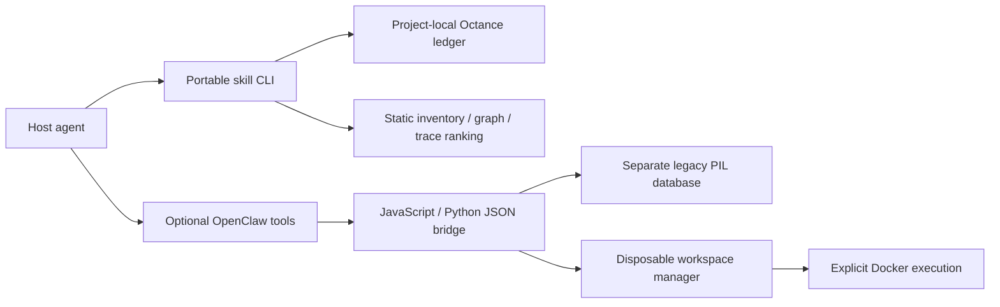

# Project review — 2026-11-15

Octance's core is a portable, project-local evidence ledger. Its strongest property is the separation of observations, claims, and an auditable event history. The main maintenance risk is that the repository also ships a second, older engine with a different database, feature set, and execution boundary. Changes must be validated against both entry paths.

## Component map

| Component | Responsibilities | State and boundaries |
| --- | --- | --- |
| `octance/SKILL.md`, root `SKILL.md` | Host-agent workflow and capability limits | Two path-adjusted copies; a contract test checks consistency |
| `scripts/octance.py` | Repository convenience entry point | Imports the portable implementation |
| `octance/scripts/octance/cli.py` | Argument validation, identity/permission checks, JSON responses | The standalone skill needs Python 3.9+ and no third-party packages |
| `octance/scripts/octance/core.py` | Project identity, evidence, claims, search, event reducers, integrity, briefings | `.octance/octance.db`, `project.json`, and `config.json` per project |
| `source.py`, `polygraph.py`, `ast_backend.py` | Extension inventory, trace ranking, dependency extraction, optional Tree-sitter parsing | Read-only heuristics; do not execute analyzed code or establish causation |
| `openclaw/index.js`, `openclaw/bridge.js` | Register 12 optional native tools and transport JSON to Python | Operator-configured project roots; subprocess size and timeout limits |
| `octane/openclaw_bridge.py`, `octane/db.py` | Native tool dispatch and the older Project Intelligence Layer | Separate operator-configured SQLite database; not the portable ledger |
| `octane/exploration.py`, `octane/workspace.py` | Older Python scanning, graph exploration, snapshot comparison, Docker execution | Execution is limited to explicit Docker workspaces/images; portable Octance has no runner |

Writes validate the actor and references, redact known secret patterns, compute a source revision, and append an event and its materialized records in one SQLite transaction. The external JSON log anchor advances after the database commit. Reads reconstruct effective claim statuses from append-only transitions. Search prefers FTS5 and falls back to SQL candidate filtering plus whole-term matching.

## Fixes and regression coverage

Each behavioral defect below was reproduced with a failing regression test before its fix.

| Defect | Result after the change |
| --- | --- |
| Evidence search fallback inspected `payload_json` after row conversion had renamed it to `payload` | Terms found only in nested structured evidence are returned without FTS5 |
| An explicit idempotency key could return another agent's evidence record | Reusing a key with a different actor is rejected |
| Explicit status retries compared mutable predecessor state or bypassed conflict checking | A retry returns the original transition without reapplying it; incompatible reuse is rejected even when the requested status is current |
| Valid JSON with invalid metadata/config/anchor shapes crashed or was silently accepted | CLI commands reject malformed objects through structured errors; doctor remains usable |
| Verification read an old database head followed by a newly advanced anchor | Reading the anchor first prevents false truncation errors during valid concurrent writes |
| Replay read events and materialized tables from different committed states | One WAL read transaction keeps the comparison consistent while writers continue |
| Registered compound suffixes were ignored by inventory | Longest registered suffix wins, including case-insensitive matching |
| Git's quoted/line-delimited output damaged unusual paths | NUL-delimited paths preserve Unicode, whitespace, quotes, and embedded newlines |
| Workspace comparison followed a directory replaced by a symlink | Every path component is checked before reading either counterpart; the difference is reported as a symlink |
| JavaScript tested `workspace.` but operation names use `workspace_run` | A 300-second run receives a 310-second bridge deadline, including cleanup time |

The subprocess transport is now independently testable in `openclaw/bridge.js`. Node tests exercise real Python bridge calls and validate the npm package contents. Packaging includes the extracted bridge module and documentation referenced by the README. `.gitignore` now covers the current `.octance/` state directory as well as legacy state.

## Validation

Local environment: Python 3.12.3, Node.js 26.13.0. No live OpenClaw Gateway or Docker container was started.

- Standard-library suite: `PYTHONDONTWRITEBYTECODE=1 python3 -m unittest discover -s tests -q` — 71 tests, OK; one skip because the optional parser is absent.
- Isolated virtual environment installed with `pip install '.[ast]'`: 73 tests, OK; two expected skips for dependency-absence cases. Actual Tree-sitter parsing tests ran.
- `npm test`: three passing tests covering timeout boundaries, real bridge round trips/errors, and package contents.
- `node --check` passed for both JavaScript modules; `git diff --check` passed.
- A copied skill directory, outside the repository and without repository `PYTHONPATH`, successfully ran init, evidence, claim, dependency graph, verify-log, and replay comparison.
- The three-case synthetic localization benchmark still reports ranked top-1/MRR of 1.00/1.00. Its format-aware traceback baseline also scores 1.00/1.00; recent-change scores 0.00/0.00. This is a mechanics check and demonstrates no improvement over the traceback baseline.

The added GitHub Actions workflow covers portable Python 3.9, full Python 3.11/3.12/3.14, the optional parser on Python 3.12, and Node bridge/package checks. Remote CI has not been run from this review; only the local checks above are claimed as executed.

## Remaining limits and next priorities

1. **Keep the phase gate explicit.** Static dependency edges and trace scores do not prove runtime reachability or root cause. A representative dataset and replayable check design must precede claims of diagnostic quality or new continuity features.
2. **Measure large-ledger behavior.** Each write computes a project revision and verifies the event history. Startup maintains search indexes; fallback search can inspect more rows than the returned result limit. These costs deserve measurement before optimization or scale claims.
3. **Define briefing budgets precisely.** The current estimate covers selected claim records, not the full serialized CLI response. Task text, the response envelope, duplicated unknowns, and pretty-print whitespace can exceed the advertised estimate. This review documents the existing contract rather than silently changing output behavior.
4. **Keep filesystem guarantees modest.** The comparison fix blocks the reproduced directory-symlink case. Path checks are not an OS security boundary or a complete defense against concurrent filesystem replacement. Source scans are best-effort snapshots and can race with edits.
5. **Exercise deployed integrations.** Bridge and package tests do not replace live Gateway registration, Windows/macOS validation, or Docker timeout/cleanup tests. The optional grammar bundle was exercised on Linux/Python 3.12 only.
6. **Consolidate schema evolution deliberately.** The portable ledger has one numbered migration plus additive startup compatibility logic; the PIL has its own migrations. Future changes should preserve existing stores and keep their migration paths distinct.

## Primary references checked

- [Git diff options](https://git-scm.com/docs/diff-options): `-z` preserves pathnames and separates them with NUL bytes.
- [SQLite FTS5](https://www.sqlite.org/fts5.html): tokenizer behavior and optional full-text search capabilities; backend-independent Unicode equivalence is not claimed.
- [GitHub checkout](https://github.com/actions/checkout), [setup-python](https://github.com/actions/setup-python), and [setup-node](https://github.com/actions/setup-node): action usage for the added workflow.
